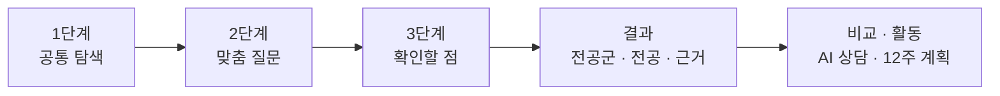
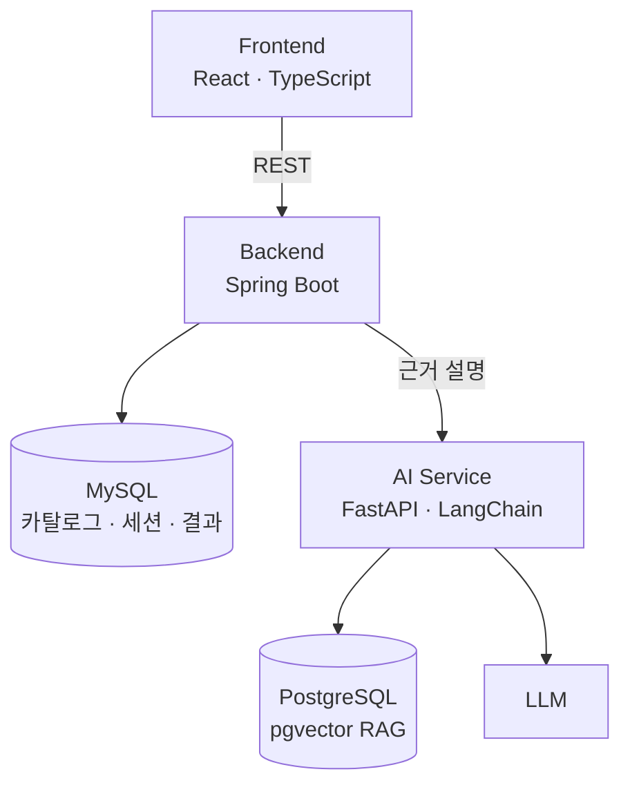

**진로온** · 영남대학교 종합설계 2026

 

## 🧭 진로온은

전공을 고르기 전에 **무엇부터 알아봐야 할지** 정리해 주는 전공 탐색 웹 플랫폼입니다.

진로온은 능력이나 적성을 판정하지 않습니다. 관심 있는 분야, 해보고 싶은 활동, 배우고 싶은 내용을 묻고,
그 응답을 근거로 **먼저 탐색해볼 수 있는 전공군과 전공**을 보여 줍니다. 결과마다 어떤 응답이 근거가 됐는지,
근거가 부족한 부분은 어디인지 함께 표시하고, 전공 비교·탐색 활동·AI 상담·12주 탐색 계획으로 이어집니다.

 

## 🔄 진단 흐름

| 단계 | 하는 일 | 최대 문항 |
|---|---|---|
| 1단계 공통 탐색 | 관심 분야와 해본 활동을 확인하고 후보 전공군을 정합니다 | 42 |
| 2단계 맞춤 질문 | 정해진 후보군 안에서 활동·학습 방식·전공 비교 질문을 필요한 만큼만 묻습니다 | 24 |
| 3단계 확인할 점 | 탐색 전에 알아두면 좋은 부담 요소를 확인합니다 (점수에는 쓰지 않음) | 12 |
| 결과 | 최대 3개 전공군 · 7개 전공, 근거와 부족한 근거를 보여 줍니다 | — |

문항 풀은 187개지만 응답에 따라 필요한 질문만 나오므로, 결과 전까지 실제로 답하는 문항은 최대 78개입니다.

 

## 🧮 추천 방식

점수에 쓰는 응답은 **관심 · 활동 · 학습** 세 가지뿐입니다.

| 축 | 묻는 것 | 구성 |
|---|---|---|
| 관심 | 어떤 분야·주제에 끌리는지 | 14개 축 (데이터, 공학, 생명, 교육, 미디어 …) |
| 활동 | 그 분야에서 어떤 방식의 일을 하고 싶은지 | 11개 축 (시스템, 설계, 탐구, 창작, 운영 …) |
| 학습 | 대학에서 무엇을 배우고 싶은지 | 12개 세트 |

1. 응답마다 0 · 25 · 50 · 75 · 100점을 주고, "모름"과 "경험 없음"은 평균에서 뺍니다.
2. **관심 점수로 후보 전공군을 먼저 정합니다.** 75점 이상인 관심 응답이 하나 이상 있어야 하고, 상위 2개 전공군에 3위가 2위와 5점 이내면 3위까지 보여 줍니다.
3. 후보 전공군 안에서 전공별 점수를 계산해 탐색 순서를 정합니다.

**전공 점수 = 관심 × 0.62 + 활동 × 0.28 + 학습 × 0.10**

학습 응답이 없으면 관심 72% · 활동 28%로 계산하고, 근거가 빠진 요소는 남은 비중을 100%로 다시 맞춥니다.
전공 비교·부담 요소·진로 상태 응답은 결과 설명에만 쓰고 점수는 바꾸지 않습니다.

> **예시 — 소프트웨어학과**
> 관심 80점(데이터 87.5 × 0.7 + 공학 62.5 × 0.3) · 활동 72.5점(시스템 · 설계 · 창작) · 학습 75점
> → 80 × 0.62 + 72.5 × 0.28 + 75 × 0.10 = **77.4점**

같은 응답과 같은 규칙 버전이면 항상 같은 질문 순서와 같은 결과가 나옵니다. 현재 시각이나 랜덤값은 쓰지 않고, 동점은 전공 코드 순으로 정합니다.

 

## 🤖 AI의 역할

| AI가 하는 일 | AI가 하지 않는 일 |
|---|---|
| 확정된 결과와 승인된 전공 자료로 추천 근거를 설명합니다 | 점수 · 순위 · 후보를 계산하지 않습니다 |
| 결과를 바탕으로 상담에 답하고 12주 탐색 계획을 만듭니다 | 합격 · 취업 가능성이나 능력 · 성격을 단정하지 않습니다 |
| 인용한 문장이 근거 자료 원문과 일치하는지 검증한 뒤에만 표시합니다 | 근거가 없는 연결을 억지로 만들지 않습니다 |

후보 선정은 서버 규칙이 하고, AI는 설명을 돕는 별도 서비스로 분리했습니다. AI 서비스가 꺼져 있어도 진단과 결과는 동작합니다.

 

## ✨ 주요 기능

| 기능 | 설명 |
|---|---|
| 🧭 **전공 탐색 진단** | 응답에 따라 다음 질문을 서버가 정하는 3단계 진단. 중간에 나가도 이어서 진행 |
| 📊 **결과와 근거** | 전공군 · 전공 · 근거가 된 응답 · 부족한 근거 · 확인해볼 점. 전체 후보도 열람 가능 |
| ⚖️ **전공 비교** | 후보 전공 2개를 나란히 비교 |
| 🧪 **탐색 활동** | 전공별로 검토한 탐색 활동 카드와 활동 기록 |
| 💬 **AI 상담 · 전공 설명** | 결과와 승인 자료를 근거로 한 전공별 설명과 상담 |
| 🗓️ **12주 탐색 계획** | 고른 전공의 활동을 주차별 계획으로 정리 |
| 🔗 **이력 · 공유** | 진단 이력 조회, 결과 공유 링크 |
| 🛠️ **관리자** | 문항 · 전공 · 활동 카탈로그 검토 기록과 활성화 관리 |

 

## 🏗️ 시스템 구성

 

 

 

 

## 🗂️ 데이터

| 항목 | 수량 |
|---|---|
| 전공 | 94개 · 전공군 11개 |
| 문항 풀 | 187개 (선택지 1,360개) |
| 전공 비교 세트 | 32개 |
| 전공별 주의 태그 | 846행 |

문항 · 선택지 · 전공 매핑 · 추천 규칙은 버전별 카탈로그로 관리합니다. 적재할 때 SHA-256 해시 · 수량 · 버전 · 참조 관계를 검증하고, 하나라도 다르면 적재를 거부합니다. 진단을 시작하면 그 회차가 쓰는 문항과 규칙 버전을 고정하므로, 나중에 카탈로그가 바뀌어도 지난 결과는 달라지지 않습니다.

 

## 📦 리포지토리

| 리포지토리 | 내용 |
|---|---|
| [**JOFE**](https://github.com/JinroOn/JOFE) | 프론트엔드 — 진단 · 결과 · 비교 · 활동 · AI 상담 · 계획 · 관리자 화면 |
| [**JOBE**](https://github.com/JinroOn/JOBE) | 백엔드 — Spring Boot API, 탐색 진단 엔진, 데이터 카탈로그, AI 서비스(`ai-service/`) |
| [JOAI](https://github.com/JinroOn/JOAI) | 초기에 만든 AI 리포지토리. 현재 AI 서비스 코드는 JOBE의 `ai-service/`에 있습니다 |

 

## 👥 팀원

<table>
  <tr>
    <td align="center">
      <a href="https://github.com/rhwnsdud70">
         
        <b>고준영</b>
      </a> 
      Backend · AI
    </td>
    <td align="center">
      <a href="https://github.com/vinn81">
         
        <b>김가빈</b>
      </a> 
      Backend · AI
    </td>
    <td align="center">
      <a href="https://github.com/ryu2293">
         
        <b>류승래</b>
      </a> 
      Backend
    </td>
    <td align="center">
      <a href="https://github.com/FAITRUEE">
         
        <b>이성진</b>
      </a> 
      Frontend
    </td>
    <td align="center">
      <a href="https://github.com/dusdnd301">
         
        <b>김연웅</b>
      </a> 
      Frontend
    </td>
    <td align="center">
      <a href="https://github.com/ryudayeong">
         
        <b>류다영</b>
      </a> 
      Frontend
    </td>
  </tr>
</table>

 

## 📌 프로젝트 상태

2026년 11월에 종합설계 프로젝트로 마무리했습니다.

- 문항 · 임계값 · 전공 매핑은 구현을 위해 정한 후보 값입니다. 실제 사용자 파일럿과 전문가 검수로 검증하는 단계는 진행하지 않았습니다.
- 탐색 진단은 데모용 개발 모드로 운영합니다. 정식 공개를 위한 승인 절차는 구현하지 않았고, 결과 공유 링크도 외부 공개 없이 검증용으로만 열려 있습니다.
- 남은 과제: AI 전공 설명의 2차 품질 평가, 운영 환경의 실행 · 공유 범위 결정
  ([JOBE #152](https://github.com/JinroOn/JOBE/issues/152), [#166](https://github.com/JinroOn/JOBE/issues/166))

 

